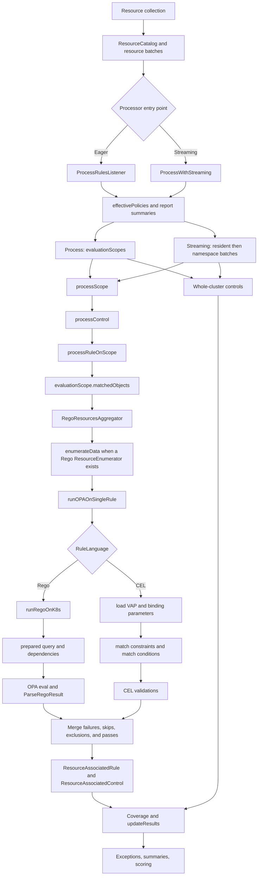

# OPA and CEL Evaluation Flow

This document describes how `core/pkg/opaprocessor/` evaluates policy rules against collected resources and turns their verdicts into scan results. The processor supports both Rego rules and Kubernetes ValidatingAdmissionPolicy (VAP) rules written in CEL.

## Key concepts

- **Framework** — a benchmark containing controls.
- **Control** — a group of policy rules and their reporting metadata.
- **PolicyRule** — a Rego or CEL rule with resource-matching metadata.
- **ResourceCatalog** — the thread-safe catalog of collected and synthesized resources. The processor uses it for resource lookups, updates, iteration, and scope snapshots.
- **Evaluation scope** — a resident batch of cluster-scoped and external resources, optionally combined with one namespace batch. Whole-cluster controls are handled separately after the scoped pass.
- **Rego dependencies** — posture control inputs and data such as the cloud provider passed to Rego.
- **VAP** — a ValidatingAdmissionPolicy loaded from the embedded policy bundle. It supplies CEL variables, match constraints, match conditions, validations, and parameter configuration.
- **RuleResponse / `celOutcome`** — the common failure-response shape, plus CEL-specific skipped and excluded resources. Excluded CEL resources are outside admission scope; skipped resources have no definitive verdict.
- **ResourceAssociatedRule / ResourceAssociatedControl** — Kubescape's per-resource rule and control results.

## End-to-end flow

## Processor entry points and scopes

`ProcessRulesListener` is the eager entry point. It applies the control filters, converts the selected frameworks to policies, initializes report summaries, and calls `Process`.

`Process` partitions collected Kubernetes and external resources into evaluation scopes. The resident scope runs first, followed by namespace scopes in deterministic order. Each scope runs its controls through `processScope`; controls are processed by workers, with the configured timeout applied independently per control and scope. Whole-cluster controls run after the scoped pass according to the configured whole-cluster execution policy.

`ProcessWithStreaming` receives a resident resource batch first, then namespace batches. It evaluates each namespace batch together with the resident resources as it arrives, adding resources to the session catalog for later result processing. Whole-cluster controls are deferred until the batches are available. Streaming bounds the evaluation input to the resident batch plus one namespace batch; resources are still retained in the catalog for downstream stages.

Both entry points initialize policies and summaries before evaluation and then build scan coverage, update results, mark not-evaluated controls, calculate scores, and build namespace summaries.

## Rule evaluation

`processScope` dispatches controls to workers. `processControl` evaluates each rule in a control and combines the returned per-resource rule results into control results.

`processRuleOnScope` obtains matching resources from `evaluationScope.matchedObjects`. Matching uses the indexes built for the scope's Kubernetes, external, and resident resources. `RegoResourcesAggregator` may combine or synthesize the rule's input objects. If the Rego rule declares a `ResourceEnumerator`, `enumerateData` runs that pre-pass and limits which resources can be reported; it does not replace the full aggregated input used by the rule. CEL rules must not declare a `ResourceEnumerator`, because their scope comes from the VAP's match constraints.

`runOPAOnSingleRule` dispatches by `PolicyRule.RuleLanguage`:

### Rego

`runRegoOnK8s` obtains the rule module and asks `getPreparedQuery` for its compiled, cached OPA query. The query receives the resource input and the rule's Rego dependencies. `regoEval` evaluates it and `reporthandling.ParseRegoResult` converts the result set into `RuleResponse` values.

### CEL

`runCELOnK8s` loads the control's VAP and the shared CEL evaluator. It resolves any applicable live binding and parameter object, then checks the policy's match constraints and match conditions before running validations. The evaluator applies the policy's variables, failure policy, and cost budget to each object.

CEL outcomes distinguish:

- **Violation** — converted to a failed `RuleResponse`.
- **Excluded** — the object is outside the policy's match scope and is omitted from results.
- **Skipped** — an evaluation error prevents a definitive verdict, so the object must not be inferred as passing.
- **Pass** — no failure or skip was recorded for an in-scope object.

An expression error under `failurePolicy: Fail` is a violation, consistent with admission. Offline-only errors such as exhausted evaluation budget remain unknown and are reported as skipped.

## Merging verdicts and building the report

After a successful rule evaluation, `processRuleOnScope` seeds failed resources from `RuleResponse` values, records CEL skips, omits CEL exclusions, and infers passes only for remaining in-scope inputs. It attaches remediation paths and related-resource IDs to failures. Incomplete dependency coverage is carried on inferred pass results rather than treated as a definitive complete scan.

`processControl` combines rules for each resource into `ResourceAssociatedControl` entries. The caller merges those results across scopes. Whole-cluster controls may use projected inputs, a full-memory fallback, skip behavior, or verification mode, depending on the configured policy.

After evaluation, `updateResults` walks the `ResourceCatalog` to remove sensitive data, applies exception policies, emits exception-match events, and appends resource results to the report summary. The processor then marks controls that were not evaluated, calculates posture scores, builds namespace summaries from the catalog, and reweights scores where needed.

## Where to add tests

The package has focused tests for the evaluation and reporting paths, including:

- `processorhandler_test.go` and `processorhandler_timeout_test.go` — rule processing and timeouts.
- `cel_error_reporting_test.go` and `cel_namespace_context_test.go` — CEL verdict handling and namespace context.
- `processorhandler_streaming_test.go` and `wholecluster_missing_control_test.go` — streaming and whole-cluster behavior.
- `incremental_cache_*_test.go` — cache replay, attribution, and result merging.

Prefer adding a regression test next to the behavior under change. CEL evaluator, VAP loading, matching, and cost-budget tests live under `core/pkg/opaprocessor/cel/`.

## See also

- `core/cautils/catalog.go` — the `ResourceCatalog` abstraction.
- `core/cautils/resourcebatch.go` — the resource-batch model used by streaming evaluation.
- `core/pkg/opaprocessor/cel/` — VAP loading, CEL evaluation, matching, and parameter resolution.
- `core/pkg/policyhandler/` — where frameworks and controls are loaded before evaluation.
- `github.com/kubescape/regolibrary` — the Rego rules.
- `github.com/kubescape/opa-utils/reporthandling` — policy and result types shared with the processor.
